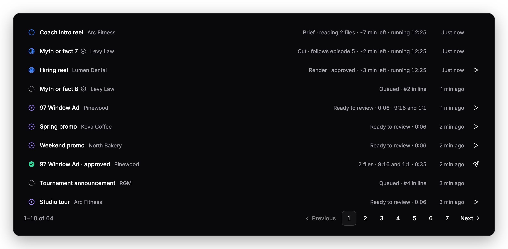
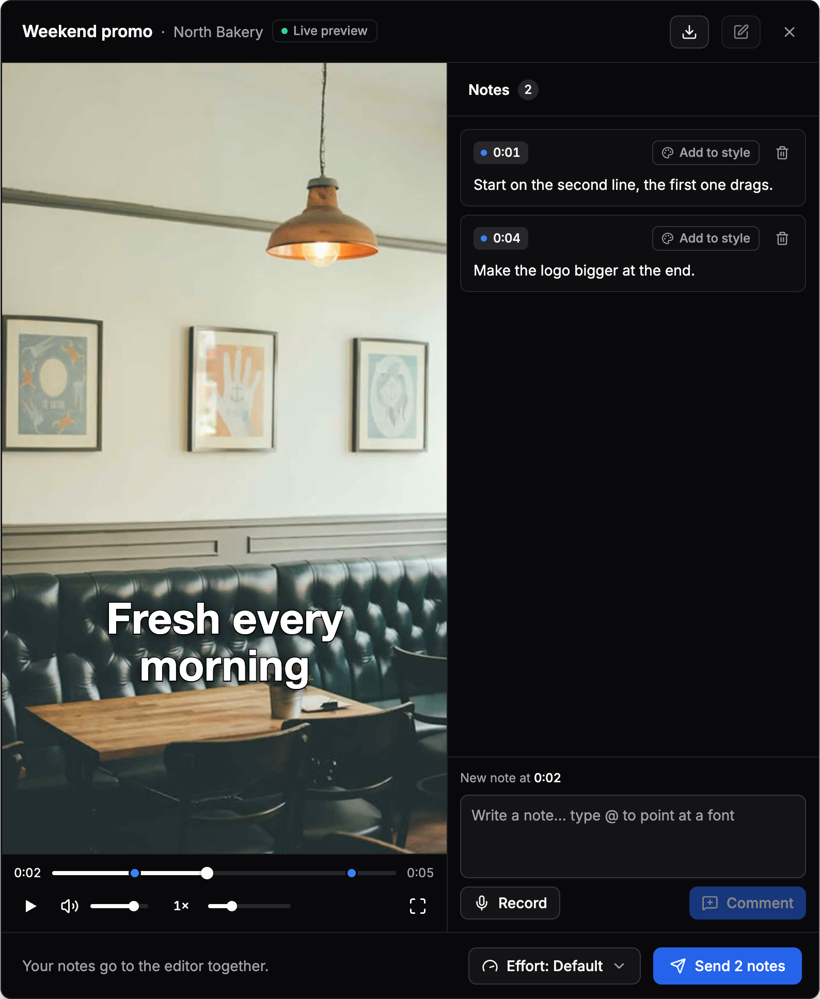
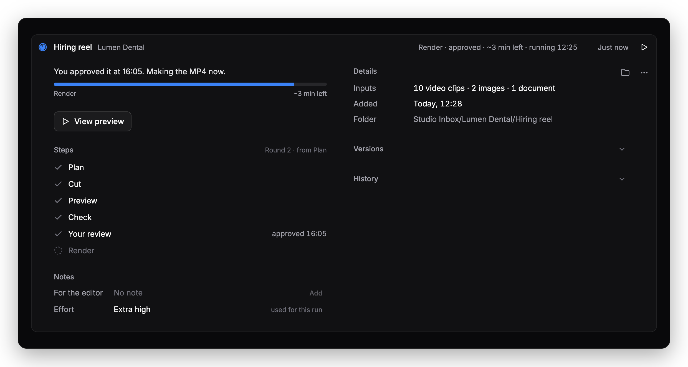
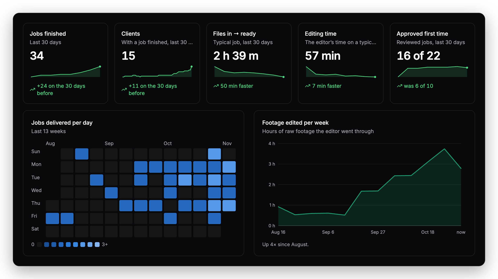
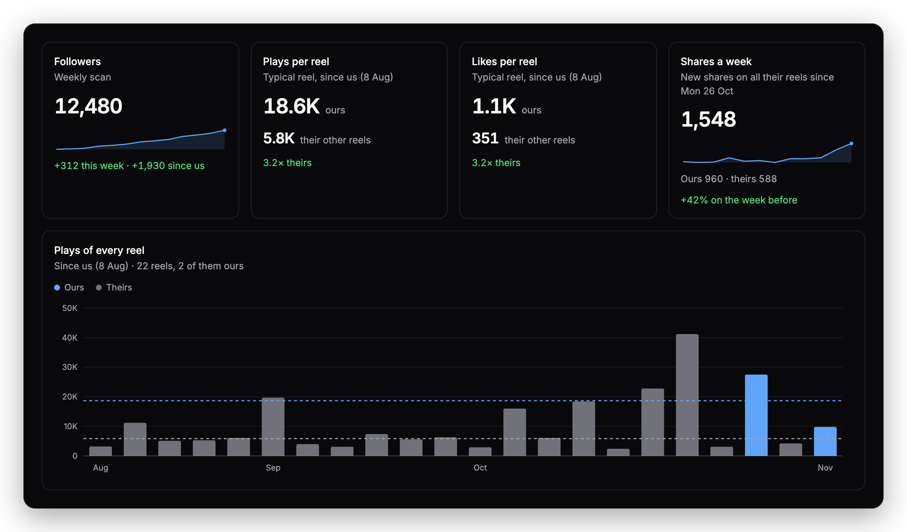
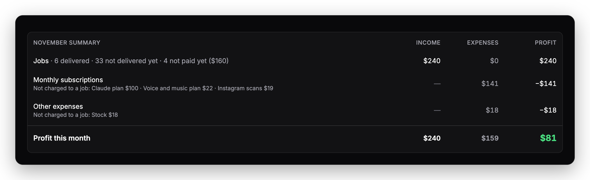
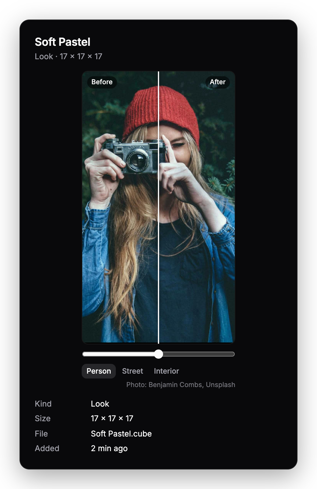
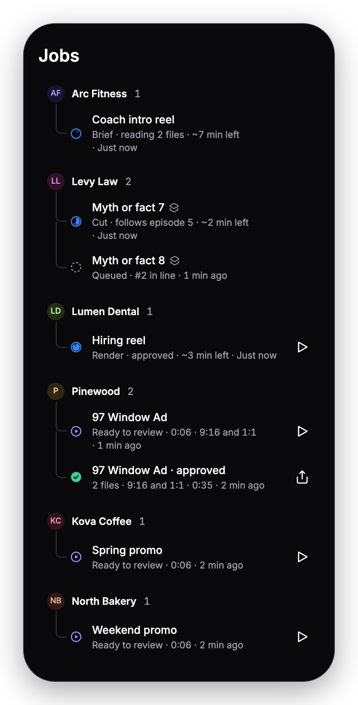

# Studio Engine

**Drop raw footage in a folder. Get an edited video back.**

Studio Engine runs on your own computer and edits every job with [Claude Code](https://claude.com/claude-code). It cuts, captions and grades the video, then waits for your notes before it renders.



## How it works

1. **Drop** your footage into `~/Studio Inbox/<Client>/<Job>`.
2. **It edits by itself:** cuts, captions, graphics, colour and music, with every step on screen.
3. **Review** it in a live player. Type or record a note at any moment, and it makes a new version.
4. **Approve,** and the final video lands in `_Exports/<Client>/<Job>.mp4`.

<p align="center">
  
</p>



## What else it does

- **Client styles and series.** Each client keeps its own look, and the episodes of a series share one design.
- **Your graphics, fonts and LUTs.** Import them or ask for them in a chat, then name them in a note with `@`.
- **Videos with no footage.** Write a brief and it generates the shots and the voice.
- **Right-to-left captions.** Hebrew captions come out the right way round.
- **Money and Analytics.** See what each job earned and cost, and how fast you deliver.
- **Instagram.** Compare the reels you edited with the client's other reels.
- **Your phone.** Review and approve on your iPhone through Tailscale.

<table>
  <tr>
    <td width="50%"></td>
    <td width="50%"></td>
  </tr>
  <tr>
    <td colspan="2"></td>
  </tr>
  <tr>
    <td></td>
    <td></td>
  </tr>
</table>

<sub>Every image is a real component from the app, rendered on its own with sample data.</sub>

## Try it

The `demo` branch runs the whole app on made-up data, with no keys, no footage and no Claude login. You need Node 22 and pnpm.

```bash
git clone -b demo https://github.com/asafsanany/studio-engine.git
cd studio-engine
pnpm i
pnpm demo
```

Then open <http://127.0.0.1:4320>. Nothing edits for real, and pressing Ctrl+C removes the data.

## Run it for real

You need Node 22, pnpm, ffmpeg and Claude Code logged in.

```bash
git clone https://github.com/asafsanany/studio-engine.git
cd studio-engine
pnpm i
mkdir -p ~/.studio-engine
cp config.example.json ~/.studio-engine/config.json
cp money.example.json ~/.studio-engine/money.json
cp .env.example .env
pnpm run doctor
pnpm dev
```

`pnpm run doctor` checks everything an edit needs and prints the fix for anything missing, including the two editing skills. `.env.example` says what each key is for. Then open <http://localhost:5173>.

## Learn more

- [Reference](docs/reference.md): settings, running in the background, the phone setup and how edits run.
- [`skills/video-use`](skills/video-use/README.md) and [`skills/edit-video`](skills/edit-video/README.md): the editing skills.

## License

[MIT](LICENSE). A few bundled files keep their own terms, including GSAP, which isn't open source. They're listed in [`THIRD_PARTY_NOTICES.md`](THIRD_PARTY_NOTICES.md).
